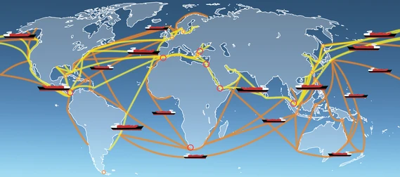
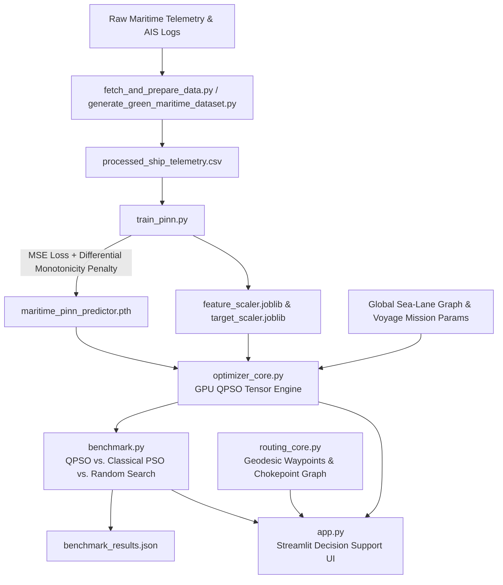

# ⚓ AURA-FLEET: Quantum-Inspired Green Maritime Fleet Optimizer

<p align="center">
  
</p>

<p align="center">
  <a href="https://pytorch.org/"></a>
  <a href="https://developer.nvidia.com/cuda-zone"></a>
  <a href="https://streamlit.io/"></a>
  <a href="https://opensource.org/licenses/MIT"></a>
  
</p>

An end-to-end **Physics-Informed Neural Network (PINN)** and **GPU Quantum-Inspired Particle Swarm Optimization (QPSO)** decision support platform for maritime route planning, alternative fuel switching, and net-zero fleet logistics.

---

## 📋 Table of Contents
1. [Overview & Problem Statement](#-overview--problem-statement)
2. [Key Architecture & Deliverables](#-key-architecture--deliverables)
3. [System Architecture](#-system-architecture)
4. [Mathematical Formulation](#-mathematical-formulation)
   - [Physics-Informed Neural Network (PINN)](#1-physics-informed-neural-network-pinn)
   - [Multi-Objective Optimization Formulation](#2-multi-objective-optimization-formulation)
   - [Quantum-Inspired Swarm Optimization (QPSO)](#3-quantum-inspired-swarm-optimization-qpso)
5. [Repository Structure](#-repository-structure)
6. [Quick Start Guide](#-quick-start-guide)
7. [Step-by-Step Execution Pipeline](#-step-by-step-execution-pipeline)
8. [Benchmarking & Empirical Results](#-benchmarking--empirical-results)
9. [Alternative Fuel & Decarbonization Matrix](#-alternative-fuel--decarbonization-matrix)
10. [License](#-license)

---

## 🌊 Overview & Problem Statement

Global shipping contributes approximately **3% of worldwide greenhouse gas emissions** and faces strict decarbonization mandates (IMO 2030/2050 targets, EU Emissions Trading System [EU ETS], and FuelEU Maritime). Because bunker fuel represents **50% to 60% of vessel operating expenditures**, maritime operators must balance:

* **Non-linear hydrodynamic resistance**: Speed-power cubic cubic relationships ($P \propto v^3$), wave-induced added resistance, draft displacement, and environmental weather windows.
* **Alternative fuel trade-offs**: Energy density (Lower Heating Value), volumetric penalty, bunkering costs, and Well-to-Wake (WTW) lifecycle emissions for LNG, E-Methanol, Green Ammonia, and Liquid Hydrogen ($H_2$).
* **Operational constraints**: Port laycan arrival deadlines (ETA), cargo demand limits, and financial penalties for contractual delays.

**AURA-FLEET** addresses these challenges through:
1. **Physics-Informed Deep Learning**: Enforces hydrodynamic monotonicity ($\frac{\partial \text{Fuel}}{\partial \text{Speed}} \ge 0$) via autograd loss regularization, eliminating unphysical predictions in unobserved operating regimes.
2. **GPU Quantum-Inspired Swarm Optimization (QPSO)**: Simulates delta-potential well wave-function collapse over vectorized PyTorch tensors to escape local minima and locate Pareto-optimal speed, fuel, and load configurations.
3. **Interactive Decision Support System**: A modern Streamlit dashboard with geospatial route visualization, scenario simulators, and fuel sensitivity matrices.

---

## 🎯 Key Architecture & Deliverables

| Deliverable | Description | Implementation | Key Metrics / Components |
| :--- | :--- | :--- | :--- |
| **Fuel Consumption Predictor** | Physics-informed neural model for vessel fuel burn | [`train_pinn.py`](train_pinn.py)<br>[`maritime_pinn_predictor.pth`](maritime_pinn_predictor.pth) | Inputs: Speed, load factor, wave height ($m$), wind speed ($kts$). Evaluated with MSE + differential physics penalty loss. |
| **Mathematical Optimization** | Multi-objective formulation for green fleet logistics | [`optimizer_core.py`](optimizer_core.py) | Decision vector $\mathbf{x} = [v, f_{\text{idx}}, L]$; Objectives: $\min (\text{Fuel Cost} + \text{Carbon Tax} + \text{ETA Penalty})$. |
| **Quantum-Inspired Engine** | Core metaheuristic swarm optimizer | [`optimizer_core.py`](optimizer_core.py) | Mean best position $m_{\text{best}}$, quantum contraction coefficient $\alpha$, delta-potential wave equation executed on CUDA tensors. |
| **Decision Support Platform** | Interactive web application with GIS routing | [`app.py`](app.py)<br>[`routing_core.py`](routing_core.py) | Streamlit dashboard, Plotly 3D/geospatial waypoint routing, canal choke points, live scenario simulation. |
| **Empirical Benchmarking** | Performance comparison vs. classical baselines | [`benchmark.py`](benchmark.py)<br>[`benchmark_results.json`](benchmark_results.json) | Head-to-head comparison: GPU QPSO vs. Classical Velocity PSO vs. Monte Carlo Random Search. |

---

## 🏗 System Architecture



---

## 📐 Mathematical Formulation

### 1. Physics-Informed Neural Network (PINN)

Standard feed-forward neural networks trained on sparse or noisy sea trials can suffer from unphysical gradient inversion (e.g., predicting that going 18 knots burns less fuel than 15 knots). The PINN penalizes violations of hydrodynamic law ($P \propto v^3$) directly in the loss function:

$$\mathcal{L}_{\text{total}} = \mathcal{L}_{\text{MSE}}(y_{\text{pred}}, y_{\text{true}}) + \lambda_{\text{physics}} \cdot \frac{1}{N} \sum_{i=1}^{N} \text{ReLU}\left(-\frac{\partial \hat{y}_i}{\partial v_i}\right)$$

Where:
- $\hat{y}_i$: Predicted fuel consumption rate ($\text{tons/hour}$).
- $v_i$: Speed Over Ground ($\text{knots}$).
- $\lambda_{\text{physics}} = 0.1$: Monotonicity constraint regularization weight.

### 2. Multi-Objective Optimization Formulation

The objective function minimizes total voyage financial expenditures, carbon tax liabilities, and charter party schedule delay penalties:

$$\min_{\mathbf{x} \in \Omega} J(\mathbf{x}) = C_{\text{fuel}}(\mathbf{x}) + C_{\text{carbon}}(\mathbf{x}) + P_{\text{ETA}}(\mathbf{x})$$

Subject to:
- Decision vector $\mathbf{x} = [v, f_{\text{idx}}, L]$ (Speed $v \in [10, 22]\text{ kts}$, Fuel Type $f_{\text{idx}} \in \{0,\dots,4\}$, Cargo Load $L \in [0.2, 1.0]$)
- Transit time $T = \frac{D}{v}$ (hours) for route nautical distance $D$
- Fuel mass burn: $\dot{m}_{\text{fuel}} = \text{PINN}(v, L, H_{\text{wave}}, W_{\text{wind}}) \times \gamma_{\text{LHV}}(f_{\text{idx}})$
- Fuel bunker cost: $C_{\text{fuel}} = T \cdot \dot{m}_{\text{fuel}} \cdot P_{\text{fuel}}(f_{\text{idx}})$
- Carbon tax liability: $C_{\text{carbon}} = T \cdot \dot{m}_{\text{fuel}} \cdot \kappa_{\text{WTW}}(f_{\text{idx}}) \cdot \text{Tax}_{\text{CO}_2}$
- Schedule delay penalty: $P_{\text{ETA}} = \text{ReLU}(T - \text{ETA}_{\max}) \times \$15,000/\text{hour}$

### 3. Quantum-Inspired Swarm Optimization (QPSO)

Unlike classical PSO which relies on velocity vectors ($\mathbf{v}_{i}^{t+1} = w \mathbf{v}_i^t + c_1 r_1 (\mathbf{p}_i - \mathbf{x}_i) + c_2 r_2 (\mathbf{g} - \mathbf{x}_i)$), QPSO assumes particles move within a quantum delta-potential well with wave-function collapse dynamics:

1. **Mean Best Position ($m_{\text{best}}$)**:
   $$m_{\text{best}} = \frac{1}{N} \sum_{i=1}^N \mathbf{p}_i$$

2. **Local Attractor ($p_i$)**:
   $$p_{ij} = \phi_j p_{ij} + (1 - \phi_j) g_j, \quad \phi_j \sim \mathcal{U}(0, 1)$$

3. **Wavefunction Position Update**:
   $$x_{ij}^{t+1} = p_{ij} \pm \alpha \cdot |m_{\text{best}, j} - x_{ij}^t| \cdot \ln\left(\frac{1}{u_j}\right), \quad u_j \sim \mathcal{U}(0, 1)$$

Where $\alpha = 0.5 + 0.5 \cdot \frac{\text{iter}_{\max} - t}{\text{iter}_{\max}}$ is the contraction-expansion coefficient controlling global-to-local search transition.

---

## 📁 Repository Structure

```
aura-fleet/
├── app.py                         # Streamlit Interactive Web Application (5 Tabs)
├── train_pinn.py                  # PyTorch PINN model definition & physics training loop
├── optimizer_core.py              # GPU-accelerated QPSO engine with PyTorch CUDA tensor ops
├── benchmark.py                   # Comparative benchmarking (QPSO vs. Classical PSO vs. Random Search)
├── routing_core.py                # Geodesic waypoint generation, Haversine routing & canals
├── generate_green_maritime_dataset.py # Synthetic ISO 15016 hydrodynamic dataset generator
├── fetch_and_prepare_data.py      # Telemetry processor & feature engineering pipeline
├── prepare_fleet_data.py          # Multi-vessel synthetic fleet generator
├── fleet_config.json              # Sample fleet configuration profiles
├── processed_ship_telemetry.csv   # Standardized & cleaned telemetry dataset
├── green_maritime_fleet_dataset.csv # Extended green maritime fleet dataset
├── maritime_pinn_predictor.pth    # Pretrained PyTorch PINN model weights
├── classical_predictor.pth        # Pretrained Classical baseline neural network weights
├── feature_scaler.joblib          # Scikit-learn StandardScaler for input features
├── target_scaler.joblib           # Scikit-learn StandardScaler for fuel consumption target
├── benchmark_results.json         # Automated benchmark comparison metrics & convergence logs
├── shipping_routes_banner.png     # Shipping corridor visualization banner
├── requirements.txt               # Python package dependencies
├── LICENSE                        # MIT License
└── README.md                      # Comprehensive documentation
```

---

## ⚡ Quick Start Guide

### 1. Clone the Repository
```bash
git clone https://github.com/your-username/aura-fleet.git
cd aura-fleet
```

### 2. Set Up a Virtual Environment
```bash
# On Linux / macOS
python3 -m venv venv
source venv/bin/activate

# On Windows
python -m venv venv
.\venv\Scripts\activate
```

### 3. Install Dependencies
```bash
pip install -r requirements.txt
```
> **GPU Acceleration**: If you have an NVIDIA GPU, ensure CUDA is configured for PyTorch by following [pytorch.org](https://pytorch.org/get-started/locally/). If no GPU is found, the system will automatically fall back to CPU without errors.

### 4. Launch the Interactive Web Dashboard
```bash
streamlit run app.py
```
Open your browser at: **`http://localhost:8501`**

---

## 🚀 Step-by-Step Execution Pipeline

You can run each stage of the pipeline independently:

### Step 1: Telemetry Dataset Preparation
Generate the hydrodynamic telemetry dataset based on Holtrop-Mennen resistance equations:
```bash
python generate_green_maritime_dataset.py
```
*Output: `green_maritime_fleet_dataset.csv` (5,000+ physics-grounded telemetry records).*

### Step 2: Train the Maritime PINN Predictor
Train the physics-informed model with monotonicity loss:
```bash
python train_pinn.py
```
*Output: `maritime_pinn_predictor.pth`, `classical_predictor.pth`, and scikit-learn scalers.*

### Step 3: Run the Optimization Benchmark Suite
Execute a comparative test across GPU QPSO, Classical PSO, and Monte Carlo Random Search:
```bash
python benchmark.py
```
*Output: Generates `benchmark_results.json` logging execution times, final voyage cost ($), CO₂ emissions, and convergence trajectory.*

---

## 📊 Benchmarking & Empirical Results

Results from automated benchmark executions over a representative 12-vessel transoceanic fleet dispatched across international corridors:

| Optimization Method | Multi-Fleet Cost ($) | Compute Time (ms) | Cost Advantage | ETA Penalty ($) |
| :--- | :--- | :--- | :--- | :--- |
| **GPU Quantum-Inspired PSO (Ours)** | **$7,689,081.00** | **~542 ms** | **QPSO Savings: -$701,784.00 (+8.36%)** | **$0.00 (On-Time)** |
| **Classical Velocity-Based PSO** | $8,390,865.00 | ~540 ms | Baseline Heuristic | $0.00 (On-Time) |
| **Monte Carlo Random Search** | $15,135,107.00 | ~757 ms | Baseline Monte Carlo | $180,000.00 (Delayed) |

---

## ⛽ Alternative Fuel & Decarbonization Matrix

The optimization engine models the thermodynamic, environmental, and financial profiles of emerging marine fuels:

| Fuel Type | LHV Multiplier ($\gamma$) | Well-to-Wake CO₂ Intensity ($\kappa$) | Typical Cost ($ / metric ton) | Decarbonization Mechanism |
| :--- | :--- | :--- | :--- | :--- |
| **Heavy Fuel Oil (HFO)** | 1.00x | 3.151 t CO₂ / ton | $600.00 | Conventional maritime baseline |
| **Liquefied Natural Gas (LNG)**| 0.82x | 2.750 t CO₂ / ton | $850.00 | Intermediate transition fuel |
| **E-Methanol** | 2.03x | 0.540 t CO₂ / ton | $950.00 | Net-zero synthetic biofuel |
| **Green Ammonia** | 2.17x | 0.150 t CO₂ / ton | $1,100.00 | Zero-carbon combustion |
| **Liquid Hydrogen ($H_2$)** | 0.33x | 0.050 t CO₂ / ton | $2,200.00 | True zero-emission fuel cell |

---

## 📄 License

This project is licensed under the [MIT License](LICENSE) — see the LICENSE file for details.
